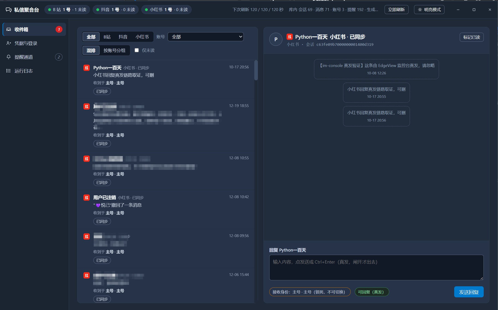

# InboxScout

> **Windows inbox for Chinese creator platforms: watches Bilibili, Douyin and Xiaohongshu DMs over plain HTTP — no browser, no automation — and pings you on WeCom or DingTalk when something new lands.**

把 B站、抖音、小红书的创作者私信塞进一个窗口：多号轮询、新消息推到企业微信、回复框就在对话下面。
数据通路全是**纯 HTTP 协议**，不起浏览器、不装插件、不做自动化点击；界面是本地 HTML 由系统 WebView2 画。

单个 x64 可执行文件，工程是中文语法的 `.lcpp`（[灵码 LingBuilder](https://lingbuilder.com/)）——
**但它编译出来就是普通 C++**，下面专门有一节讲这件事。源码以 **lcpppkg 源码包**形式提供。

## 界面




> 后两张待补（拍法与脱敏要求见 `docs/screenshots/README.md`）。这里不放设计评审稿——
> 那批图里是编出来的假数据，拿它当"实机截图"就是骗人。上图是真机截图：混排列表、
> 三平台筛选、会话详情与底部回复框（发送=真发，默认闸关时只会回 GATED 提示）。

## 能做什么

| | 状态 | 说明 |
|---|---|---|
| B站 私信读取 | ✅ 已实测 | `api.vc.bilibili.com` 的 `get_sessions` / `single_unread`，免签名，带 cookie 即 `code:0` |
| 小红书 私信读取 | ✅ 已实测 | 走 `x-s` 签名全链路，**必须 `chrome-131` TLS 指纹**（裸 WinHTTP 会被 302 到验证码页） |
| 抖音 私信读取 | ⚠️ 离线已验，在线待授权 | 直连 `imapi.douyin.com` protobuf，不需要 `a_bogus`；在线拉取会标已读，默认关着 |
| B站 回复 | ⚠️ 代码完成，真发未取证 | `POST /web_im/v1/web_im/send_msg`，`msg[键]` 表单；必需项只有登录 cookie + `csrf`(`bili_jct`)，WBI 可选 |
| 抖音 回复 | ⚠️ 代码完成，真发未取证 | `/v1/message/send`，靠回包里回显的 `client_message_id` 判投递 |
| 小红书 回复 | ⛔ 未取证 | 发侧是 RWP 帧，不是 HTTP send 接口。**没测出来的东西界面就不给按钮** |
| 企业微信提醒 | ⚠️ 组包/台账/限流已验，真发默认关 | 攒一轮发一条，正文只放摘要，绝不含 cookie 与票据 |
| 钉钉加签提醒 | ⬜ 未开始 | HMAC-SHA256 需手搓 |
| B站 扫码登录 | ✅ 取码链路已验 | 二维码 180 秒过期，**过期自动换下一张**（上限 8 张）；扫描那一下必须人做 |
| Cookie 粘贴导入 | ✅ 验证通过才入库 | 三平台各打一条只读接口验登录态，不认就不写库 |
| 周期自动轮询 | ⬜ 未接 | 现在靠启动时一轮 + 界面「立即刷新」 |

**快手整条出局**（PC 端没有私信入口），不做，也不复用任何相关代码。

## 技术要点（踩过的坑都在这儿）

- **同一个工具里，TLS 指纹必须按平台分档**。小红书要 `chrome-131`，抖音反过来必须裸 WinHTTP（一上 Chrome 仿真就被 `blocked`）。共用一个 HTTP 客户端就掉线。
- **B站私信不在你以为的域名下**。在 `api.vc.bilibili.com`，发送口还在第三个命名族 `web_im` 下（不是 `msg_svr`）。
- **19 位的 `msg_key` 按数字解析会静默丢精度**（`7697254699486048745 > 2^53`），全链路按字符串走。
- **回复身份锁死**成"收到这条消息的那个号"，不给切；默认干跑只落台账，关掉干跑后每条真发都读回确认，超时标"结果不确定"且**绝不自动重试**。
- **凭据只落本机**：`%LOCALAPPDATA%\自媒体私信聚合\creds.db`，明文 SQLite（自用不加密，这是取舍不是疏忽），界面只显掩码与位数。仓库里不含任何凭据。
- 每个号可单独配代理，留空即直连；每号独立 cookie 罐、独立间隔。

## 用的是灵码 IDE，但代码是 C++

`.lcpp` **不是脚本、不是解释执行、也没有偷偷套一层解释器**。它是中文语法的源码，构建时由灵码
**确定性地翻译成真实 C++（Win32）**，再交给 MSVC `cl` 编成原生 x64 PE。性能、依赖面、可调试性
都请按"这就是一个 C++ 程序"来预期。

本机证据，不是宣传话术：

| 看到什么 | 说明 |
|---|---|
| 构建日志 `编译器：msvc (cl)`、`0 个错误` | 走的就是 Visual Studio 工具链 |
| 导出目录里有 `dm-aggregator.sln` + `.vcxproj` + `main.cpp` + `lingbuilder_runtime.h` | 生成物是一份**标准 VS 工程**，拖进 Visual Studio 就能读 |
| 构建中间目录 `…/x64/Debug/src/main.cpp` | 真正喂给 `cl` 的，就是这份生成的 C++ |
| 产物目录只有 `exe + sqlite3.dll + libcurl-impersonate.dll + botan-3.dll + cacert.pem`（外加一圈第三方 LICENSE 文本） | **运行期不需要装灵码**，也没有解释器；界面另要系统的 WebView2 Runtime |

那为什么还用灵码：中文语法 + 可视化设计器 + 内置模块（HTTP、SQLite、线程池、**TLS 指纹**、二维码、
EdgeView），把最难啃的底层封成命令。尤其 `libcurl-impersonate` 那层 Chrome TLS 指纹——本项目
"小红书必须 `chrome-131`、抖音必须裸 WinHTTP"这条分档，纯手写 C++ 的话光接库和踩坑就要多花好几天。
一个人写得动，是它最大的价值。

一句提醒：`.lcpp` 是唯一事实源。导出的那份 C++ 会被重新生成覆盖，**要改逻辑请改 `.lcpp`**。

## 仓库里有什么

只有四样：`README.md`、`LICENSE`（MIT）、`docs/`（赞助图与截图位）、`InboxScout.lcpppkg`（源码包）。

**没有 `src/`，是故意的。** 灵码工程除了 `.lcpp` 源码，还依赖 IDE 侧的模块清单、设计器模型与构建配置，
散着提交会出现"照着仓库拼不出一个能编译的工程"这种更难用的状态；`.lcpppkg` 是官方的一键导入载体，
IDE 会把项目结构与所依赖模块一起恢复。**要读源码，导入后在 IDE 里看就是最完整的那份。**

## 上手

### 1. 装灵码

装 [LingBuilder](https://lingbuilder.com/)（Windows，需要 MSVC x64 工具链）。界面用 WebView2，机器上要有 Evergreen Runtime（装过 Edge 的机器一般都有）。

### 2. 一键导入源码包

本仓库**只发布 `.lcpppkg` 源码包**，不含 IDE 工程二进制。拿到后：

```
LingBuilder → 文件(F) → 打开 LCPP 源码包…
```

IDE 会自动恢复项目结构与所依赖的模块，不需要手工配依赖。按 → `F5` 即可编译并运行。

> 官方图文教程（含导出方怎么打包、导入后常见报错）：
> <https://lingbuilder.com/docs/guide/tutorials/lcpp-source-package#%E7%AC%AC-5-%E7%AB%A0-%E5%AF%B9%E6%96%B9%E6%8B%BF%E5%88%B0%E5%90%8E-%E4%B8%80%E9%94%AE%E5%AF%BC%E5%85%A5>

### 3. 挂上你的号

进「凭据与登录」页：

- **B站**：点「获取登录二维码」→ 用**哔哩哔哩 App 的「扫一扫」**对准 → 手机上点确认。
  相机/微信/浏览器只会把链接解出来，不会去 B站 登记这次扫码，服务端不收，轮询就永远停在"未扫码"。
- **抖音 / 小红书**：从已登录的浏览器里复制整串 cookie，粘进「手动导入 cookie」，工具会先打一条只读接口验登录态，**验不过不入库**。

### 4. 配提醒（可选）

企业微信群机器人 webhook 存 `%LOCALAPPDATA%\自媒体私信聚合\wecom.txt`（仓库外，不进日志、不进提醒正文）。
默认是**干跑**：只写台账不外发。要真推，在库里把 kv `提醒真发` 置 `1`。

## 已知缺陷

- **混合 DPI 下搬窗口或改尺寸会让界面白屏**（主屏 150% / 副屏 100% 这台机器实测）。数据通路不受影响，只是那一屏不渲染。
- 启动后**立刻**移动或缩放主窗口，内嵌浏览器内核会永远初始化不成功——所以程序自己不碰窗口位置。
- 上面状态表里所有 ⚠️ 与 ⛔，都是"没测出来"而不是"测出来不行"。文档里标"未取证"的地方，请不要当结论用。

## 安全与合规（请先读这段）

- 本项目通过**逆向公开网页接口**实现，未使用任何平台的开放 API，也不持有任何服务端权限。这可能违反平台服务条款，**风险自负**；请只挂你自己的账号、只用于个人消息管理。
- 不提供、也不欢迎用于：批量群发、营销引流、养号刷量、绕过平台风控或频率限制。工具默认干跑、白名单、限流，就是为了让"顺手一发"变成一件要想清楚的事。
- 仓库不含任何凭据、Cookie、webhook key 或代理账密。请不要把 `creds.db`、`wecom.txt`、抓包样本提交进来。
- 欢迎提改进，但**不要**在 Issue 里贴你的 cookie、二维码原图或响应原文——那些东西一旦公开就等于泄露登录态。

## 反馈

- **Bug 反馈只有一个渠道：[Issues](https://github.com/mosheng20205/InboxScout/issues)。** 私信、群聊、评论里的反馈我一律不回，也不是不回，是真记不住、也查不到。
  提的时候麻烦带上：系统版本、灵码版本、复现步骤、程序目录下生成的报告文件内容（`dm_selftest.txt` / `dm_round.txt`，里面没有凭据）。
- 交流 QQ 群：**1083244094**（聊用法、聊逆向、提需求；报 bug 请还是走 Issues）。

## 请我喝一杯咖啡

如果这东西帮你省下了在三个 App 之间来回切的时间：


## 许可

[MIT](LICENSE)。随便用、随便改、随便商用，保留版权声明即可。

两句丑话跟着一起生效：① 上面「安全与合规」那节不是装饰——MIT 授予的是**代码**的权利，
不含任何平台的服务条款豁免，拿去商用前先自己把那条路走通；② 按 MIT 的 "AS IS"，
这东西不提供任何保证，账号被限流、被封、消息发重了，责任在使用方。
